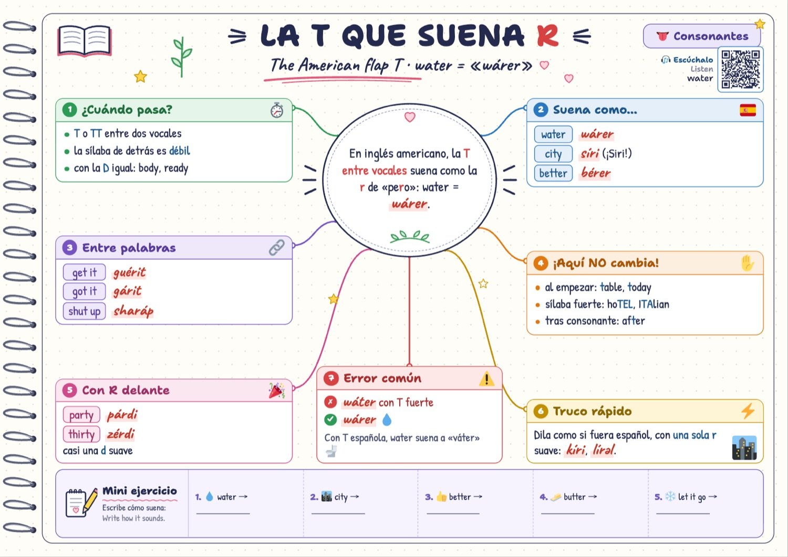
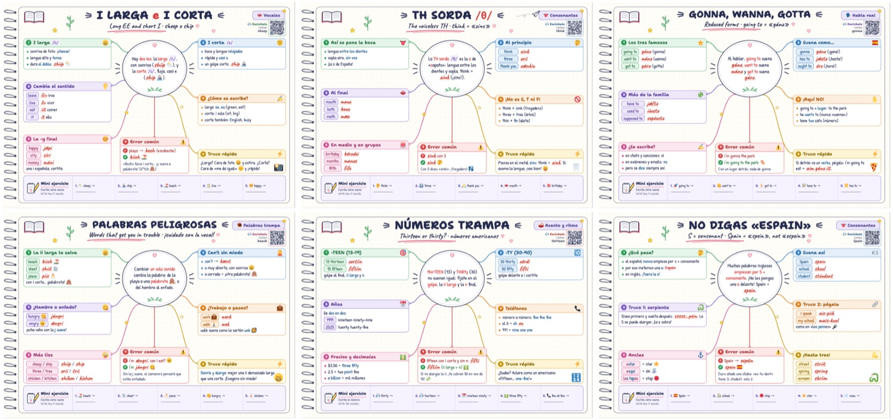
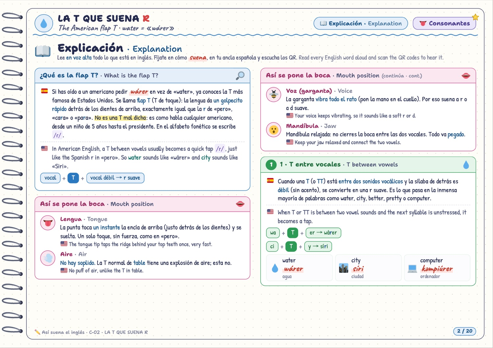
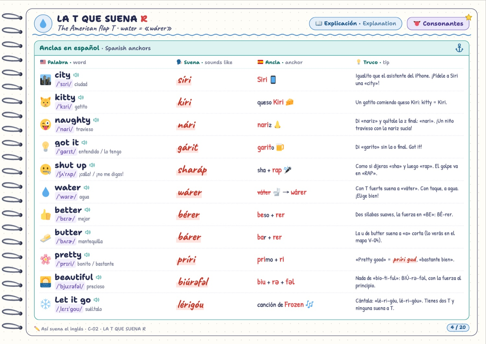
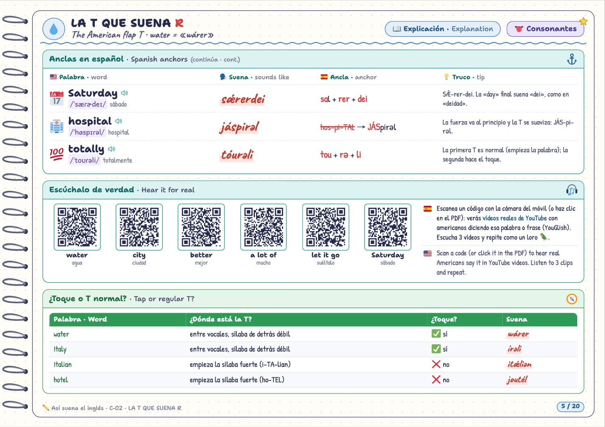
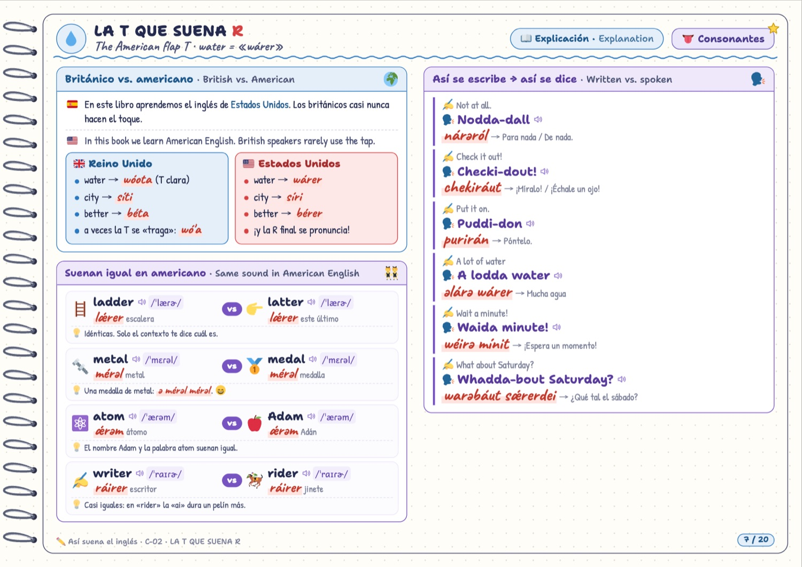
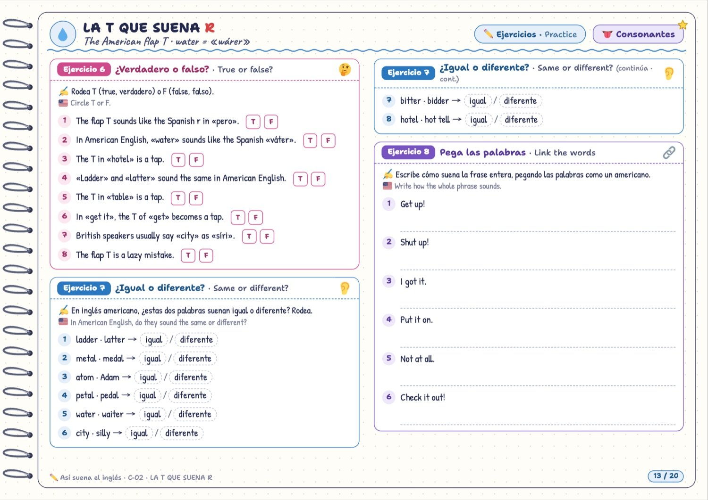
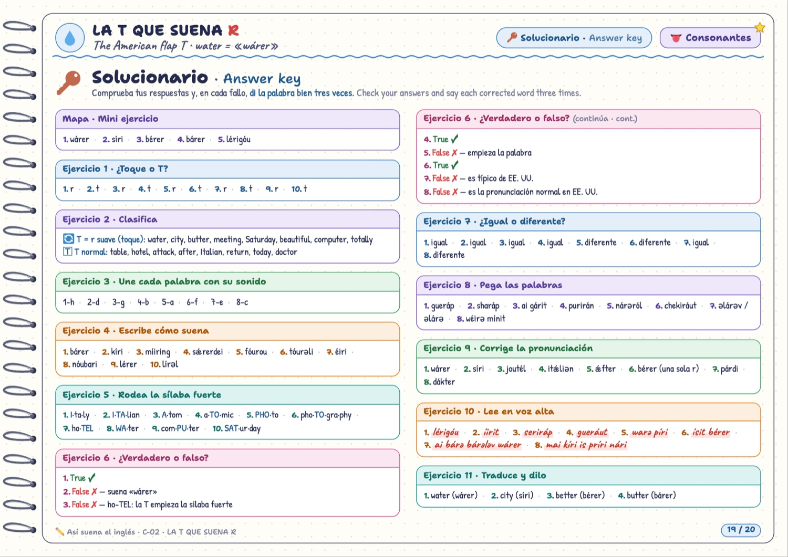

<div align="center">

# 🗣️ Así suena el inglés

### Mapas mentales para aprender la **pronunciación del inglés americano** con trucos en español

**55 mapas · 1075 páginas · 848 ejercicios · 8002 preguntas con solucionario · 703 anclas en español · 385 códigos QR con audio real**

[](LICENSE-CONTENT.txt)
[](LICENSE)
[](#-por-qué-inglés-americano-y-sin-niveles)
[](#-qué-es)
[](#-descargas)



</div>

> **¿Por qué un americano dice _«wárer»_ cuando pide agua?** ¿Por qué _city_ suena igual que _Siri_? ¿Por qué si dices _«Espain»_ te miran raro?
> Este proyecto responde a todo eso con **mapas mentales coloridos**, una **pronunciación figurada** que cualquier hispanohablante sabe leer, **anclas en español** para no olvidarlo nunca y **códigos QR** que te llevan a escuchar a americanos de verdad. Gratis y libre para todo el mundo. 💚

---

## 📚 Índice

- [🤔 Qué es](#-qué-es)
- [🇺🇸 Por qué inglés americano y sin niveles](#-por-qué-inglés-americano-y-sin-niveles)
- [⚓ El truco: anclas en español](#-el-truco-anclas-en-español)
- [🗣️ Cómo se lee la pronunciación figurada](#️-cómo-se-lee-la-pronunciación-figurada)
- [🎧 Los QR: escucha a americanos de verdad](#-los-qr-escucha-a-americanos-de-verdad)
- [📊 En números](#-en-números)
- [⬇️ Descargas](#️-descargas)
- [🗺️ Los 7 bloques y los 55 mapas](#️-los-7-bloques-y-los-55-mapas)
- [🔍 Cómo es cada PDF por dentro](#-cómo-es-cada-pdf-por-dentro)
- [✏️ Tipos de ejercicio](#️-tipos-de-ejercicio)
- [👨‍👩‍👧 Cómo estudiar con estos mapas](#-cómo-estudiar-con-estos-mapas)
- [🖨️ Imprimir](#️-imprimir)
- [🛠️ Para desarrolladores: generar los PDF](#️-para-desarrolladores-generar-los-pdf)
- [🤝 Contribuir](#-contribuir)
- [⚖️ Licencias](#️-licencias)
- [🙏 Créditos](#-créditos)

---

## 🤔 Qué es

**Así suena el inglés** es una colección de **55 fichas en PDF** (una por concepto) para aprender a **pronunciar** y a **entender** el inglés hablado de Estados Unidos. Está pensada para hispanohablantes de cualquier edad: sirve igual a un niño de 8 años que a un adulto que lleva media vida estudiando inglés y sigue sin entender las series.

Cada PDF tiene la misma estructura:

1. 🗺️ **Un mapa mental** a todo color, como una página de cuaderno: la idea clave en el óvalo central, 6 cajas con lo esencial, el error más común y un mini ejercicio. Arriba a la derecha, un **QR para escuchar** la palabra estrella.
2. 📖 **La explicación**, en español 🇪🇸 con su versión en inglés 🇺🇸: cómo se pone la boca, las reglas, las **anclas españolas**, parejas de palabras que solo se distinguen por un sonido, cómo se escribe y cómo se dice de verdad, frases para leer en voz alta, errores típicos, un diálogo y trabalenguas.
3. ✏️ **Ejercicios** (13-16 por mapa) de fácil a difícil: reconocer, clasificar, escribir cómo suena, marcar la sílaba fuerte, corregir, traducir… y siempre **leer en voz alta**.
4. 🏆 **Repaso**: lista de «Lo sé decir» y estrellas para colorear.
5. 🔑 **Solucionario** completo.

El proyecto hermano, **[English all levels](https://github.com/oskarko/English-all-levels)**, hace lo mismo con la gramática del A1 al C2. Este se centra en **cómo suena**.

## 🇺🇸 Por qué inglés americano y sin niveles

- **Americano** porque es el que más oímos en series, películas, YouTube, videojuegos y canciones, y porque tiene rasgos muy marcados que, si nadie te los explica, hacen que no entiendas nada: la **T que suena R** (_water_ → «wárer»), la **T que desaparece** (_button_ → «bá'n»), la **R** que se pronuncia siempre, **gonna**, **wanna**… Cuando hay diferencias con el británico, lo decimos.
- **Sin niveles** porque **el speaking es speaking**: la _th_ de _think_ o la _-ed_ de _worked_ se pronuncian igual en A1 que en C2. Los mapas están organizados por **temas**, no por cursos. Empieza por el bloque 1 y luego salta a lo que más te cueste.

## ⚓ El truco: anclas en español

Una **ancla** es una palabra española que **ya sabes decir** y que esconde el sonido inglés. Si la recuerdas, recuerdas la pronunciación para siempre:

| Inglés | Suena | Ancla española |
|---|---|---|
| **train** (tren) | `trein` | **trein**ta 🚆 |
| **how** (cómo) | `jau` | **jau**la 🐦 |
| **toy** (juguete) | `toi` | es**toy** 🧸 |
| **city** (ciudad) | `síri` | **Siri** 📱 |
| **think** (pensar) | `zink` | **zinc** 🔩 |
| **got it** (entendido) | `gárit` | **garit**o 💡 |
| **water** (agua) | `wárer` | ⚠️ con T española suena a «**váter**» 🚽 |

Hay **703 anclas** repartidas por todos los mapas. Todas son originales y están comprobadas en voz alta: el trozo en negrita, dicho en castellano, suena como la palabra inglesa.

> 💡 **Ojo con un truco muy famoso.** Mucha gente aprende «_playa = beach_: di _escabeche_ y quítale la _e_ final → _bech_». Cuidado, porque ese «bech» se parece más a la **i corta** /ɪ/ de… una palabrota (b\*tch). _Beach_ se dice con una **i larga y sonriente**: `biich`. Lo explicamos con detalle (y con humor) en el mapa **V-02 · I larga e i corta**.

## 🗣️ Cómo se lee la pronunciación figurada

En los PDF, la pronunciación «a la española» aparece en **letra manuscrita roja**, por ejemplo <code>wárer</code>. Se lee como en español, con estas reglas:

| Escribimos | Significa | Ejemplo |
|---|---|---|
| tilde (á, é…) | la **sílaba fuerte**, siempre marcada | water → `wárer` |
| `ii`, `uu` | vocal **larga** | beach → `biich`, food → `fuud` |
| `i`, `u` | vocal **corta y relajada** (la i casi suena e) | ship → `ship`, good → `gud` |
| `ə` | la **schwa**, una e perezosa y cortita | about → `əbáut` |
| `æ` | una **a con boca de e** | cat → `kæt` |
| `j` | una **h suave**, como echar vaho en un cristal (nunca jota fuerte) | hello → `jəlóu` |
| `z` | la **z castellana** de «zapato» (sonido /θ/) | think → `zink` |
| `d` | en _the_, _this_, _mother_: la **d suave** de «nada» | the → `də` |
| `v` | **v de verdad**, con los dientes en el labio | very → `véri` |
| `y` | una y fuerte (como «yo» enfático) | job → `yab` |
| `r` | **una sola r**, nunca vibrante (ni la R americana ni la T que suena R) | water → `wárer` |
| `'` | la **T que se traga** (golpe de garganta) | button → `bá'n` |

Además, cada palabra lleva su transcripción en el **alfabeto fonético internacional (IPA)** americano, por ejemplo /ˈwɑɾɚ/, para quien quiera precisión. El mapa **B-01** explica todo el sistema y el **B-02** tiene la tabla completa de sonidos.

## 🎧 Los QR: escucha a americanos de verdad

Un papel no suena, así que cada mapa trae **códigos QR**: uno en la portada del mapa y un bloque «Escúchalo de verdad» con 4-6 más en la explicación. Escanéalos con la cámara del móvil, o haz clic en ellos si lees el PDF en pantalla. Te llevan a **[YouGlish](https://youglish.com)**, que te enseña **vídeos reales de YouTube** con americanos diciendo esa palabra o frase. Además, cada palabra inglesa con un 🔈 es un enlace a sus vídeos.

> El método: escucha 3 vídeos → repite como un loro 🦜 → grábate con el móvil → compara.

## 📊 En números

| | |
|---|---|
| 🗺️ Mapas (PDF) | **55** en 7 bloques |
| 📄 Páginas | **1075** (A4 apaisado) |
| ⚓ Anclas en español | **703** |
| 🎧 Códigos QR con audio | **385** |
| 💬 Ejemplos y frases para leer en voz alta | **2789** |
| ✏️ Ejercicios | **848** |
| ❓ Preguntas con solución | **8002** |
| 🌀 Trabalenguas | **158** |

## ⬇️ Descargas

- **Un mapa suelto**: entra en la carpeta [`pdf/`](pdf) o usa los enlaces de las tablas de abajo → botón «Download raw file».
- **Un bloque entero en un solo PDF** (portada + índice + todos sus mapas), en la [última versión publicada (Releases)](../../releases/latest):

  - 🚀 **1 · Empieza aquí** (3 mapas): [1-Empieza-aqui-libro-completo.pdf](https://github.com/oskarko/English-pronunciation/releases/latest/download/1-Empieza-aqui-libro-completo.pdf)
  - 👄 **2 · Vocales** (11 mapas): [2-Vocales-libro-completo.pdf](https://github.com/oskarko/English-pronunciation/releases/latest/download/2-Vocales-libro-completo.pdf)
  - 👅 **3 · Consonantes** (15 mapas): [3-Consonantes-libro-completo.pdf](https://github.com/oskarko/English-pronunciation/releases/latest/download/3-Consonantes-libro-completo.pdf)
  - 🔚 **4 · Terminaciones** (3 mapas): [4-Terminaciones-libro-completo.pdf](https://github.com/oskarko/English-pronunciation/releases/latest/download/4-Terminaciones-libro-completo.pdf)
  - 🗣️ **5 · Habla real** (10 mapas): [5-Habla-real-libro-completo.pdf](https://github.com/oskarko/English-pronunciation/releases/latest/download/5-Habla-real-libro-completo.pdf)
  - 🥁 **6 · Acento y ritmo** (6 mapas): [6-Acento-y-ritmo-libro-completo.pdf](https://github.com/oskarko/English-pronunciation/releases/latest/download/6-Acento-y-ritmo-libro-completo.pdf)
  - 🪤 **7 · Palabras trampa** (7 mapas): [7-Palabras-trampa-libro-completo.pdf](https://github.com/oskarko/English-pronunciation/releases/latest/download/7-Palabras-trampa-libro-completo.pdf)

## 🗺️ Los 7 bloques y los 55 mapas

### 🚀 1 · Empieza aquí <sub>Start here</sub>

| | ID | Mapa | De qué va | Págs. |
|---|---|---|---|---|
| 👂 | **B-01** | [Cómo suena el inglés](pdf/1-Empieza-aqui/B-01-como-suena-el-ingles.pdf) | How English sounds · empieza por aquí | 19 |
| 🗺️ | **B-02** | [El mapa de sonidos](pdf/1-Empieza-aqui/B-02-mapa-de-sonidos.pdf) | The American sound chart · tu chuleta | 20 |
| 👄 | **B-03** | [Tu boca en inglés](pdf/1-Empieza-aqui/B-03-tu-boca-en-ingles.pdf) | Your mouth in English · el gimnasio de la boca | 17 |

📚 Todo el bloque en un PDF: [1-Empieza-aqui-libro-completo.pdf](https://github.com/oskarko/English-pronunciation/releases/latest/download/1-Empieza-aqui-libro-completo.pdf)

### 👄 2 · Vocales <sub>Vowels</sub>

| | ID | Mapa | De qué va | Págs. |
|---|---|---|---|---|
| 😴 | **V-01** | [La schwa](pdf/2-Vocales/V-01-schwa.pdf) | The lazy vowel · la vocal perezosa | 19 |
| 🐑 | **V-02** | [I larga e i corta](pdf/2-Vocales/V-02-i-larga-i-corta.pdf) | Long EE and short I · sheep o ship | 19 |
| 🐱 | **V-03** | [La a de cat](pdf/2-Vocales/V-03-la-a-de-cat.pdf) | The cat vowel /æ/ · una a con boca de e | 20 |
| ☕ | **V-04** | [La U que suena A](pdf/2-Vocales/V-04-la-u-que-suena-a.pdf) | The cup vowel · una a corta y floja | 19 |
| ☕ | **V-05** | [La O que suena A (/ɑ/)](pdf/2-Vocales/V-05-la-o-que-suena-a.pdf) | The open American «ah» · hot = «jat» | 20 |
| 🌙 | **V-06** | [U larga y U corta (/uː/ y /ʊ/)](pdf/2-Vocales/V-06-u-larga-u-corta.pdf) | Food or good? · «fuud» o «gud» | 20 |
| 🚂 | **V-07** | [Diptongos con I (/eɪ/, /aɪ/, /ɔɪ/)](pdf/2-Vocales/V-07-diptongos-con-i.pdf) | Day, my, boy · ¡ya los sabes decir! | 20 |
| 🏠 | **V-08** | [OU y AU (/oʊ/ y /aʊ/)](pdf/2-Vocales/V-08-diptongos-con-u.pdf) | Go home now · no es «no», es «nou» | 20 |
| 🐦 | **V-09** | [La vocal con R (/ɝ/ y /ɚ/)](pdf/2-Vocales/V-09-vocal-con-r.pdf) | The R-colored vowel · bird = «berd» | 21 |
| 🚗 | **V-10** | [AR, OR, AIR, EAR (vocales + R)](pdf/2-Vocales/V-10-ar-or-air-ear.pdf) | Vowels before R · car, more, hair, here | 21 |
| 🪄 | **V-11** | [La E mágica (reglas de lectura)](pdf/2-Vocales/V-11-e-magica.pdf) | Magic E · la e muda que cambia la vocal | 21 |

📚 Todo el bloque en un PDF: [2-Vocales-libro-completo.pdf](https://github.com/oskarko/English-pronunciation/releases/latest/download/2-Vocales-libro-completo.pdf)

### 👅 3 · Consonantes <sub>Consonants</sub>

| | ID | Mapa | De qué va | Págs. |
|---|---|---|---|---|
| 🏴‍☠️ | **C-01** | [La R americana](pdf/3-Consonantes/C-01-r-americana.pdf) | The American R · la r que no vibra | 20 |
| 💧 | **C-02** | [La T que suena R (flap T)](pdf/3-Consonantes/C-02-flap-t.pdf) | The American flap T · water = «wárer» | 20 |
| 👻 | **C-03** | [La T que desaparece (T glotal y NT)](pdf/3-Consonantes/C-03-la-t-que-desaparece.pdf) | The disappearing T · button = «bá'n» | 20 |
| 🤔 | **C-04** | [TH sorda /θ/](pdf/3-Consonantes/C-04-th-sorda.pdf) | The voiceless TH · think = «zinc» | 19 |
| 🐝 | **C-05** | [TH sonora /ð/](pdf/3-Consonantes/C-05-th-sonora.pdf) | The voiced TH · the = «də» | 18 |
| 😮‍💨 | **C-06** | [La H suave](pdf/3-Consonantes/C-06-la-h-suave.pdf) | The breathy American H · hello = «jəlóu» | 20 |
| 🎻 | **C-07** | [V y B](pdf/3-Consonantes/C-07-v-y-b.pdf) | Teeth on your lip · very ≠ berry | 20 |
| 🐝 | **C-08** | [S y Z](pdf/3-Consonantes/C-08-s-y-z.pdf) | The buzzing Z · is, was, zoo, music | 20 |
| 🤫 | **C-09** | [SH, CH, J y ZH](pdf/3-Consonantes/C-09-sh-ch-j.pdf) | She, cheese, job & vision · the «shhh» family | 20 |
| 🐧 | **C-10** | [Y y W (los sonidos /j/ y /w/)](pdf/3-Consonantes/C-10-y-y-w.pdf) | The glides /j/ & /w/ · yes = «iés», we = «wii» | 19 |
| 🐍 | **C-11** | [No digas «Espain» (S + consonante)](pdf/3-Consonantes/C-11-s-liquida.pdf) | S + consonant · Spain = «spein», not «espein» | 18 |
| 🌑 | **C-12** | [La L oscura (dark L)](pdf/3-Consonantes/C-12-l-oscura.pdf) | The dark L · ball, milk, people | 19 |
| 🎤 | **C-13** | [-NG y -ING (el sonido /ŋ/)](pdf/3-Consonantes/C-13-ng-e-ing.pdf) | The /ŋ/ sound · sing = «sing», going = «góuing» | 20 |
| 🏁 | **C-14** | [Consonantes finales](pdf/3-Consonantes/C-14-consonantes-finales.pdf) | Final consonants · ¡no te comas el final! | 20 |
| 🤫 | **C-15** | [Letras mudas](pdf/3-Consonantes/C-15-letras-mudas.pdf) | Silent letters · se escriben, pero no suenan | 19 |

📚 Todo el bloque en un PDF: [3-Consonantes-libro-completo.pdf](https://github.com/oskarko/English-pronunciation/releases/latest/download/3-Consonantes-libro-completo.pdf)

### 🔚 4 · Terminaciones <sub>Word endings</sub>

| | ID | Mapa | De qué va | Págs. |
|---|---|---|---|---|
| ⏪ | **T-01** | [La -ed del pasado](pdf/4-Terminaciones/T-01-la-ed-del-pasado.pdf) | The -ed ending · worked, played, wanted | 20 |
| 🐍 | **T-02** | [La -s final](pdf/4-Terminaciones/T-02-la-s-final.pdf) | The final -s · cats, dogs, buses | 20 |
| 🪤 | **T-03** | [Finales trampa](pdf/4-Terminaciones/T-03-finales-trampa.pdf) | Tricky endings · -tion, -ture, -ous, -able… | 20 |

📚 Todo el bloque en un PDF: [4-Terminaciones-libro-completo.pdf](https://github.com/oskarko/English-pronunciation/releases/latest/download/4-Terminaciones-libro-completo.pdf)

### 🗣️ 5 · Habla real <sub>Real speech</sub>

| | ID | Mapa | De qué va | Págs. |
|---|---|---|---|---|
| 🔗 | **H-01** | [Palabras pegadas (linking)](pdf/5-Habla-real/H-01-palabras-pegadas.pdf) | Linking words · an apple = «a napple» | 19 |
| 🌉 | **H-02** | [Vocal con vocal (puentes de i, w y R)](pdf/5-Habla-real/H-02-vocal-con-vocal.pdf) | Linking vowels · go out = «gou-wáut» | 19 |
| 🐭 | **H-03** | [Las formas débiles (weak forms)](pdf/5-Habla-real/H-03-formas-debiles.pdf) | Weak forms · cup of tea = «kápə tíi» | 19 |
| 🚀 | **H-04** | [Gonna, wanna, gotta](pdf/5-Habla-real/H-04-gonna-wanna-gotta.pdf) | Reduced forms · going to = «gánə» | 18 |
| ✂️ | **H-05** | [Contracciones](pdf/5-Habla-real/H-05-contracciones.pdf) | Contractions · I am = «aim» | 19 |
| 🫠 | **H-06** | [Sonidos que se funden (asimilación)](pdf/5-Habla-real/H-06-sonidos-que-se-funden.pdf) | When sounds melt · did you = «díyu» | 19 |
| 🍪 | **H-07** | [Sonidos que se comen (elisión)](pdf/5-Habla-real/H-07-sonidos-que-se-comen.pdf) | Sounds that vanish · next door = «neks dór» | 20 |
| 🏊 | **H-08** | [Can y can't](pdf/5-Habla-real/H-08-can-y-cant.pdf) | Can or can't? · I can = «ai kən» | 20 |
| ☕ | **H-09** | [Frases del día a día](pdf/5-Habla-real/H-09-frases-del-dia-a-dia.pdf) | Everyday phrases · What's up? = «watsáp» | 20 |
| 🍿 | **H-10** | [Inglés de series](pdf/5-Habla-real/H-10-ingles-de-series.pdf) | TV English · Come on! = «kəmán» | 19 |

📚 Todo el bloque en un PDF: [5-Habla-real-libro-completo.pdf](https://github.com/oskarko/English-pronunciation/releases/latest/download/5-Habla-real-libro-completo.pdf)

### 🥁 6 · Acento y ritmo <sub>Stress & rhythm</sub>

| | ID | Mapa | De qué va | Págs. |
|---|---|---|---|---|
| 🎯 | **R-01** | [Dónde cae el golpe (acento de palabra)](pdf/6-Acento-y-ritmo/R-01-el-acento-de-la-palabra.pdf) | Word stress · la sílaba que manda | 20 |
| 🧲 | **R-02** | [Reglas del acento (sufijos, familias y compuestos)](pdf/6-Acento-y-ritmo/R-02-reglas-del-acento.pdf) | Stress rules · los finales mandan | 20 |
| 🥁 | **R-03** | [El ritmo del inglés (tambor, no ametralladora)](pdf/6-Acento-y-ritmo/R-03-el-ritmo-del-ingles.pdf) | English rhythm · un tambor, no una ametralladora | 20 |
| 🔦 | **R-04** | [La palabra foco (acento de frase)](pdf/6-Acento-y-ritmo/R-04-la-palabra-foco.pdf) | Sentence stress · la palabra que brilla | 19 |
| 🎶 | **R-05** | [La música del inglés (entonación)](pdf/6-Acento-y-ritmo/R-05-la-musica-de-las-preguntas.pdf) | Intonation · la voz sube ↗ y baja ↘ | 19 |
| 🔢 | **R-06** | [Números que se confunden](pdf/6-Acento-y-ritmo/R-06-numeros-que-se-confunden.pdf) | Thirteen or thirty? · números americanos | 20 |

📚 Todo el bloque en un PDF: [6-Acento-y-ritmo-libro-completo.pdf](https://github.com/oskarko/English-pronunciation/releases/latest/download/6-Acento-y-ritmo-libro-completo.pdf)

### 🪤 7 · Palabras trampa <sub>Tricky words</sub>

| | ID | Mapa | De qué va | Págs. |
|---|---|---|---|---|
| 🍕 | **P-01** | [Palabras que ya usas (cognados y préstamos)](pdf/7-Palabras-trampa/P-01-palabras-que-ya-usas.pdf) | Words you already know · ¡pero en americano! | 19 |
| 🏷️ | **P-02** | [Marcas y nombres](pdf/7-Palabras-trampa/P-02-marcas-y-nombres.pdf) | Brands & names · así los dicen en EE. UU. | 19 |
| 🙃 | **P-03** | [Nunca como se escribe](pdf/7-Palabras-trampa/P-03-nunca-como-se-escribe.pdf) | Words that break the rules · ¡no las leas a la española! | 20 |
| 🙊 | **P-04** | [Palabras peligrosas](pdf/7-Palabras-trampa/P-04-palabras-peligrosas.pdf) | Words that get you in trouble · ¡cuidado con la vocal! | 19 |
| 👯 | **P-05** | [Suenan igual (homófonos)](pdf/7-Palabras-trampa/P-05-homofonos.pdf) | Homophones · mismo sonido, otra palabra | 20 |
| 🤯 | **P-06** | [Ortografía rebelde (el caos del inglés)](pdf/7-Palabras-trampa/P-06-ortografia-rebelde.pdf) | Crazy English spelling · OUGH, EA, OO, OU… | 20 |
| 🔤 | **P-07** | [El abecedario americano](pdf/7-Palabras-trampa/P-07-el-abecedario-americano.pdf) | The American ABC · ei, bii, sii | 20 |

📚 Todo el bloque en un PDF: [7-Palabras-trampa-libro-completo.pdf](https://github.com/oskarko/English-pronunciation/releases/latest/download/7-Palabras-trampa-libro-completo.pdf)

## 🔍 Cómo es cada PDF por dentro

<div align="center"></div>

Todos los PDF siguen el mismo esquema. Este es el mapa **C-02 · La T que suena R** por dentro:

| | |
|---|---|
| **1 · El mapa mental**: óvalo central, 6 cajas, error común, QR y mini ejercicio. |  |
| **2 · Así se pone la boca** y reglas con fichas de ejemplo (con su figurada). |  |
| **3 · Anclas en español**: palabra, IPA, cómo suena, ancla y truco. |  |
| **4 · QR para escuchar vídeos reales** y tabla de «cuándo sí y cuándo no». |  |
| **5 · Británico vs. americano, palabras que suenan igual** y «así se escribe → así se dice». |  |
| **6 · Ejercicios** variados (y siempre leer en voz alta). |  |
| **7 · Solucionario** completo. |  |

## ✏️ Tipos de ejercicio

| Tipo | Qué hace el alumno |
|---|---|
| 🔍 Elegir | Rodear el sonido correcto, si dos palabras suenan igual o distinto, o cuál suena diferente |
| 🗂️ Clasificar | Repartir palabras por su sonido en columnas |
| 🔗 Unir | Unir palabras con su pronunciación figurada, su IPA o su forma hablada |
| ✍️ Escribir cómo suena | Escribir la pronunciación figurada de una palabra o frase |
| 🥁 Sílaba fuerte | Rodear la sílaba que lleva el golpe |
| 🩹 Corregir | Encontrar el fallo en una pronunciación figurada |
| 📣 Leer en voz alta | Leer 3 veces (despacio, normal, rápido) y marcar las casillas |
| 🌍 Traducir y decir | Traducir al inglés y decirlo bien |
| 📋 Completar tablas | Rellenar palabra, significado, figurada… |
| 📖 Lectura | Leer un texto en voz alta y cazar sonidos |
| 🔎 Sopa de letras | Encontrar palabras con el sonido del mapa |
| ✅ Verdadero o falso | Comprobar que se ha entendido la regla |
| 🎤 Tu turno | Inventar frases propias y grabarse |

## 👨‍👩‍👧 Cómo estudiar con estos mapas

**El método en 5 pasos** (también viene en cada libro):

1. 🎧 **Escucha primero**: escanea el QR del mapa y oye a americanos de verdad.
2. 🗺️ **Lee el mapa en voz alta**. El óvalo central es la idea clave.
3. 📖 **Lee la explicación** diciendo cada palabra inglesa como indica la figurada, exagerando un poco.
4. ✏️ **Haz los ejercicios** diciendo cada palabra antes de escribirla, y corrige con el solucionario.
5. 🎤 **Grábate** leyendo los trabalenguas y compárate con los vídeos. ¡Repite cada semana!

**Para familias** 👨‍👩‍👧: 10-15 minutos al día valen más que una hora el domingo. Haced los trabalenguas juntos y en plan concurso, gana quien lo diga 3 veces sin trabarse. Pegad el mapa de la semana en la nevera.

**Para profes** 👩‍🏫: cada mapa da para 1-2 sesiones. El mapa mental se puede proyectar; los ejercicios de «¿igual o diferente?» y «rodea el sonido» funcionan muy bien en voz alta con toda la clase, y los QR sirven como «listening» real en 30 segundos.

**Para autodidactas** 🧑‍💻: un orden que funciona es bloque 1 → vocales V-01 a V-04 → C-02, C-03, C-04, C-05 → bloque 5 (habla real) → el resto según tus puntos débiles.

## 🖨️ Imprimir

- Formato **A4 apaisado**, a color. En blanco y negro también se leen, aunque se pierde la gracia.
- Para encuadernar con espiral, deja **margen izquierdo**: el dibujo de la espiral ya está pensado para eso.
- Si solo vas a imprimir una parte: la **página 1** (el mapa) es la imprescindible; los ejercicios se pueden hacer en un cuaderno.
- Los QR se leen bien impresos desde unos 15-20 cm.

## 🛠️ Para desarrolladores: generar los PDF

Los PDF se generan a partir de ficheros **JSON** (uno por mapa) con un motor HTML/CSS que imprime Google Chrome sin ventana.

**Requisitos**: Node.js 18+ y Google Chrome (o Chromium). En macOS se usa `/Applications/Google Chrome.app` por defecto; en otro sistema, indica la ruta en la variable `CHROME`.

```bash
npm install
npm run validate                                            # valida los 55 JSON
node tools/build.mjs content/3-Consonantes/C-02-flap-t.json --png   # un mapa (+ PNG de cada página en output/png/)
node tools/build.mjs content/3-Consonantes --book           # un bloque + su libro en pdf/libros/
npm run build                                               # todo: 55 PDF + 7 libros
CHROME=/usr/bin/chromium npm run build                      # Linux
```

### Estructura

```
content/<bloque>/<ID>-<nombre>.json   ← el contenido (lo único que hay que tocar para crear o corregir un mapa)
pdf/<bloque>/<ID>-<nombre>.pdf        ← los PDF generados
tools/engine.js                       ← motor: maqueta el mapa, pagina la explicación, numera ejercicios, genera el solucionario
tools/engine.css                      ← diseño (colores, cuaderno, tarjetas, tipografías)
tools/build.mjs                       ← genera HTML → PDF con Chrome y une los libros por bloque
tools/validate.mjs                    ← comprueba formato, figurada, IPA, respuestas y cantidades
tools/blocks.json                     ← los 7 bloques (nombre, color, icono, carpeta)
SCHEMA.md                             ← formato completo de los JSON y sistema de pronunciación figurada
CURRICULUM.md                         ← temario: qué cubre cada mapa y qué no
fonts/  emoji/                        ← tipografías (SIL OFL) e ilustraciones Twemoji (CC BY 4.0)
```

### Crear o corregir un mapa

1. Lee [`SCHEMA.md`](SCHEMA.md) y mira un ejemplo completo, [`content/3-Consonantes/C-02-flap-t.json`](content/3-Consonantes/C-02-flap-t.json).
2. Edita o crea el JSON. Los textos admiten un HTML mínimo: `<b>`, `<em>`, `<mark>`, `<s>`, `<i>` y **`<code>` para la pronunciación figurada**. El IPA se escribe entre barras, `/ˈwɑɾɚ/`, y sale con su fuente fonética automáticamente.
3. `node tools/validate.mjs <fichero>`: el validador comprueba la estructura, que las respuestas de «elegir» estén entre las opciones, que la figurada use solo letras del sistema y lleve tilde, que el IPA sea americano, etc.
4. `node tools/build.mjs <fichero> --png` y revisa las imágenes. El motor avisa si algo no cabe:

| Aviso | Significa | Solución |
|---|---|---|
| `MAP TOO FULL` | el texto del mapa se ha tenido que encoger | acorta las cajas |
| `MINI EXERCISE TOO LONG` | el mini ejercicio no cabe | frases más cortas |
| `MAP TITLE TOO LONG` | título demasiado ancho | título más corto |
| `SQUEEZED block` | un bloque no cabía ni en una página vacía | divídelo |
| `MISSING EMOJI` | emoji sin dibujo | usa otro |
| `RULE ORDER` | reglas numeradas desordenadas | revisa el orden |

### Cómo funciona el motor

- Cada JSON se inyecta en una página HTML junto con `engine.js`, que **maqueta y pagina en el propio navegador**: mide lo que cabe, reparte los bloques en dos columnas, parte tablas y listas largas («continúa»), rellena huecos con bloques posteriores sin desordenar las reglas numeradas y numera los ejercicios según se colocan.
- El **mapa mental** ajusta solo el tamaño de letra para que todo quepa y dibuja las conexiones curvas desde el óvalo.
- Los **QR** se generan en el navegador con `qrcode-generator` y apuntan a YouGlish (inglés americano).
- El **IPA** se detecta en el texto y se pinta con Andika, una tipografía de SIL hecha para la lectura y el alfabeto fonético.
- Los emojis se sustituyen por SVG de Twemoji (descargados una vez a `emoji/`), para que Chrome imprima sin problemas y se vean igual en todas partes.
- Chrome imprime el PDF, y `pdf-lib` une la portada y el índice de cada libro con sus mapas.

## 🤝 Contribuir

¿Has encontrado una pronunciación dudosa, un error en el solucionario o un ancla que no funciona? ¡Abre un **issue**! Indica el mapa (por ejemplo, C-02), la página y qué cambiarías. Las mejoras de contenido se hacen editando el JSON correspondiente; antes de enviar un pull request, ejecuta `npm run validate` y genera el PDF.

Ideas bienvenidas: más anclas españolas, más trabalenguas, variantes latinoamericanas de las anclas, y una versión británica 🇬🇧.

## ⚖️ Licencias

Todo es **libre y gratuito para todo el mundo**, también para academias, colegios y uso comercial, siempre que se cite la fuente.

| Qué | Licencia |
|---|---|
| Contenido educativo (textos, ejercicios, JSON) y PDF generados | [CC BY 4.0](LICENSE-CONTENT.txt): úsalo, compártelo y adáptalo citando «Así suena el inglés, de Óscar R. Garrucho» y un enlace a este repositorio |
| Código (`tools/`) | [MIT](LICENSE) |
| Tipografías Shantell Sans, Patrick Hand, Caveat, Kalam y Andika | [SIL Open Font License 1.1](fonts) |
| Ilustraciones emoji (Twemoji) | [CC BY 4.0](emoji/LICENSE.md), © Twitter, Inc. y colaboradores |

Los QR solo enlazan a YouGlish; los vídeos pertenecen a sus autores.

## 🙏 Créditos

- Creado por **Óscar R. Garrucho** ([@oskarko](https://github.com/oskarko)), con la ayuda de Claude (Anthropic).
- Hecho con cariño para **Mario** 💚, que ya caza monstruos de gramática en **[Mario vs Word Monsters](https://github.com/oskarko/mario-vs-word-monsters)** y ahora va a por los sonidos.
- Tipografías: [Shantell Sans](https://shantellsans.com), [Patrick Hand](https://fonts.google.com/specimen/Patrick+Hand), [Caveat](https://fonts.google.com/specimen/Caveat), [Kalam](https://fonts.google.com/specimen/Kalam) y [Andika](https://software.sil.org/andika/) de SIL.
- Emojis: [Twemoji](https://github.com/jdecked/twemoji).
- Audio: [YouGlish](https://youglish.com).
